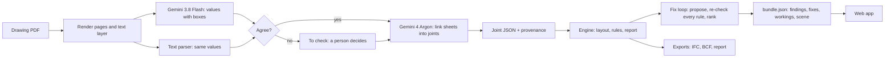

# ARCHITECTURE.md

## The system in one picture



Only the engine produces numbers. Gemini reads and proposes; the engine measures, judges and ranks.

## Repository

```
src/rebartwin/          engine (done): model, layout, geometry, rules, check, fixes, exports, report, cli
src/rebartwin/reader/   to build: PDF reading, two channels, agreement, linking
src/rebartwin/api.py    to build: FastAPI service
tests/                  engine tests (hand-checked); reader and API tests to add
examples/               joint JSON fixtures (c4_b12.json is the deck's worked example)
web/                    React app; web/src holds the v0 viewer built in Antigravity (to migrate, below)
docs/                   rules.md, orca-teardown.md, UI_RESEARCH.md
.agents/rules/          Antigravity rules loaded by file path
```

## Engine (built, 12 tests)

| Module | Job |
|---|---|
| `model.py` | `Joint`: one column, up to two beams (one per direction), bars in drawing notation, covers, aggregate, exposure, seismic zone. Millimetres. The reader's output contract |
| `layout.py` | Places every bar in 3D the way sites do: tight inside links, evenly spaced, layers in line on a spacer, crossing beams stacked |
| `geometry.py` | Exact segment-to-segment distances; gap = distance minus radii |
| `rules.py` | IS 456 spacing and cover, bar clashes, IS 13920 cl. 7.1.1 and 6.2.3; each rule records its clause and the source it was checked against |
| `check.py` | Runs the rules that apply; the only source of numbers |
| `fixes.py` | Propose, re-check every rule, retry with reasons, rank. `Proposer` protocol; `Enumerator` built in; Gemini proposer to build |
| `export_ifc.py`, `export_bcf.py` | IFC4 (bars as `IfcReinforcingBar`, `Tag` = bar id, stable GlobalIds) and BCF 2.1 |
| `report.py` | Markdown report and `bundle()`, the web contract |

Conventions: millimetres; Z up; the column's centre line is the Z axis; Z = 0 is the top of the beams; beams run
along X or Y. Bar ids: `C4/V3` (column bar 3), `B12/T1-3` (top layer 1, bar 3), `B12/B2-1` (bottom layer 2, bar 1).

## Contracts

### bundle.json (one per joint)

```
joint            Joint as read (model.py)
report           { findings[], rules_run[], rules_skipped{}, passed{}, is13920, seismic_zone, notes[] }
  finding        { rule, clause, title, status: fail|pass, measured, limit, compare: >=|<=, unit,
                   members[], bars[], at: [x,y,z] mm, message }
fix              { status: clean|fixed|redesign|no_fix, summary, options[], attempts[], blocking{} }
  option         { candidate{title, edits[], source}, faces[{beam, face, before, after, area_required,
                   area_provided, overshoot_pct, depth_before, depth_after, n_bars, n_layers}], column, flags[] }
  attempt        { round, candidate, passed, failures[{rule, clause, measured, limit, unit, message, bars[], at}] }
rules            { id: {clause, title, basis} }
scene            { units: "mm", up: "z", concrete[{id, kind, min, max}],
                   bars[{id, member, role, layer, index, dia, p0, p1, label, status, findings[]}],
                   loops[{id, member, role, dia, points[]}] }
option_scenes[]  a scene per fix option, same order
attempt_scenes[] { concrete[], bars[] } per attempt (first 60); a bar's findings index that attempt's failures
```

A bar's `findings` in `scene` index `report.findings`. The viewer never computes a number; it formats these.

### provenance.json (reader, to build)

```
{ "joint": "C4xB12",
  "fields": { "beams[0].top[0].bars": { "page": 3, "box_2d": [ymin, xmin, ymax, xmax], "text": "5-20",
              "gemini": "5-20", "parser": "5-20", "status": "agreed" } } }
```

`box_2d` is Gemini's convention: integers 0 to 1000 relative to the page image, `[ymin, xmin, ymax, xmax]`.

### to_check.json (reader, to build)

```
[{ "id": "tc_0007", "joint": "C4xB12", "field": "beams[0].top[0].bars", "page": 3, "box_2d": [...],
   "gemini": {"value": "5-20"}, "parser": {"value": "5-16"}, "reason": "disagree|missing|ambiguous",
   "resolution": null | {"value": "5-20", "by": "person", "at": "2026-11-19T10:02:00Z"} }]
```

A joint with unresolved items is shown as "To check" and is not checked until they are resolved.

## Reader (to build, Claude Code)

1. **Ingest.** PyMuPDF renders each page at 200 dpi and returns the text layer as words with boxes.
2. **Gemini channel.** `gemini-3.8-flash`, temperature 0, structured output (JSON schema): every schedule row and
   callout with member id, field, value as written, `box_2d`, page. The prompt sends the page image plus its words
   and says numbers come only from the drawing. Prompts live in `src/rebartwin/reader/prompts/` and are versioned.
3. **Parser channel.** A grammar over the text layer for Indian notation ("5-20", "2#25", "8-T16", "230x450",
   "8φ @ 150 c/c", "clear cover 25 mm", "M25", "Fe500"), mapped to word boxes. No model.
4. **Agreement.** Accept a field when both channels give the same normalised value and their boxes overlap (IoU at
   least 0.3, or one centre inside the other). Everything else becomes a To check item.
5. **Linking.** `gemini-4-argon` (fallback `gemini-3.8-flash`) assembles joints from accepted fields across
   sheets, with `Joint.model_json_schema()` as the response schema. Every default it applies is written into
   `Joint.notes` as an assumption.
6. **Evaluation.** A golden set of 60 hand-labelled callouts; report accuracy per field. Target: at least 95%
   accepted and correct, zero wrong values accepted.

Keys: an AI Studio key in `GEMINI_API_KEY` locally; Vertex AI on Cloud Run (`GOOGLE_GENAI_USE_VERTEXAI=true`).

## API (to build)

| Method and path | Does |
|---|---|
| `POST /joints/check` | Joint JSON in, bundle out. Stateless; used by demo mode and tests |
| `POST /projects` | Create a project |
| `POST /projects/{id}/drawings` | Upload a PDF; starts reading |
| `GET /projects/{id}/events` | Server-sent events: `page_started`, `page_read` (agreed, to_check), `joint_ready`, `done`, `error` |
| `GET /projects/{id}` | Sheets, joints and their status |
| `GET /projects/{id}/to-check` and `POST .../to-check/{item}/resolve` | The review queue |
| `GET /projects/{id}/joints/{joint}/bundle` | The bundle |
| `GET .../joint.ifc`, `.../fixed.ifc?option=n`, `.../issues.bcf`, `.../report.md` | Exports |
| `GET /projects/{id}/pages/{n}.png?crop=ymin,xmin,ymax,xmax` | A drawing crop for the Source panel |

Errors use `application/problem+json`. Long work runs as Cloud Tasks; the API streams progress.

## Web app

**Stack.** Vite, React 19, TypeScript (strict), Tailwind CSS v4 with tokens from DESIGN_SYSTEM.md, shadcn/ui on
Radix primitives, Motion (`motion/react`) for interface animation, three.js with an imperative `SceneController`,
`camera-controls` for camera moves, React Router 7, TanStack Query, Zustand, cmdk, sonner, lucide-react,
self-hosted fonts via @fontsource. Landing route only, lazy-loaded: GSAP with ScrollTrigger and SplitText, and Lenis.
web-ifc stays, lazy-loaded, behind "Open IFC".

**Routes.**

| Route | Screen |
|---|---|
| `/` | Landing |
| `/demo` | The worked example, offline, with the guided tour |
| `/projects/:id` | Project: sheets and joints, failures first |
| `/projects/:id/upload` | Upload and reading progress |
| `/projects/:id/review` | To check queue |
| `/projects/:id/joints/:jointId` | Joint workspace (`?f=` selected finding, `?o=` option, `?a=` attempt) |
| `/projects/:id/report` | Printable report |
| `/styleguide` | Tokens and components in both themes (dev only) |

**Folders.**

```
web/src/
  app/          router, providers, shells
  routes/       one file per route
  features/     workspace/ (Viewport, SceneController.ts, callouts, toolbar, inspector),
                findings/, fixes/, workings/, source/, reading/, review/, project/, landing/
  components/   ui/ (shadcn, generated) and shared custom components
  lib/          api.ts, coords.ts, format.ts (numbers and units), motion.ts (presets), a11y.ts
  stores/       workspace.ts (Zustand)
  styles/       tokens.css, globals.css
  types/        bundle.ts (mirrors the contract above)
```

**From the v0 viewer.** Keep `coords.ts` (the mm Z-up to m Y-up conversion) and the label-projection logic from
`Viewport3D.tsx`. Move `ifcLoader.ts` behind "Open IFC". Rebuild panels on the design system; retire
`styles.css` once nothing uses it.

**Scene.** `SceneController` builds meshes from `scene`: each bar a unit cylinder scaled to its diameter and length
and oriented from `p0` to `p1`, so a morph is a tween of position, rotation and scale; loops as tubes along their
polylines; concrete as boxes with edge lines. Picking returns `bar.id`. Labels are HTML in an overlay, projected
each frame, so text stays crisp and accessible. Before and After matches bars by id: moved bars tween, removed bars
shrink out, new bars grow in. Units convert once, in `coords.ts`: engine `(x, y, z)` mm to three.js
`(x, z, -y) × 0.001`.

**State.** Zustand holds selection, mode (before, after), option, replay (playing, index, speed), concrete and
label modes. The URL holds the joint and the selected finding, option or attempt, so any view can be shared.

**Budgets.** First render under 1.5 s on a laptop; app JavaScript under 250 KB gzipped before the 3D chunk;
60 fps orbit on integrated graphics; landing Lighthouse at least 90 for performance and accessibility.

## Google Cloud (showcase onward)

Cloud Run serves the API and the built web app. Cloud Tasks reads pages in parallel. Cloud Storage holds uploads,
deleted after export (lifecycle rule: 1 day). Firestore holds projects, joints and To check state. BigQuery logs
every model call: model, tokens, latency, cost, and whether the two channels agreed. Vertex AI serves Gemini. One
service account with only these roles; keys in Secret Manager.

## Privacy

Drawings are the client's property: never in git, never in logs, deleted after export. Crops are served through
short-lived URLs. Logs carry ids and numbers, not drawing content.

## Testing

| Layer | How |
|---|---|
| Engine | pytest with hand-checked numbers; IfcOpenShell kernel cross-check |
| Reader | parser unit tests per notation; golden-set accuracy report |
| API | pytest with FastAPI's test client |
| Web | Vitest and Testing Library for components; Playwright for the demo flow; axe on every route |

## Decisions

1. **Closed-form geometry is the truth.** A bar is a segment with a diameter, so gaps have a formula. IfcOpenShell's
   kernel re-measures the exported model as a second channel; they agree on the worked example.
2. **The web draws `scene`, not IFC.** Exact, light, easy to pick and animate. IFC and BCF are exports for BIM tools;
   web-ifc remains for opening outside IFC files.
3. **One bundle per joint.** Static-friendly, so the demo runs with no server and no network.
4. **A single-page app.** React Router view transitions and Motion's `AnimatePresence`; Barba is for multi-page sites
   and would fight the router.
5. **Motion for the interface, GSAP for the landing story.** Camera moves use `camera-controls`. Lenis on the landing
   only; never in the workspace, which has its own scroll areas.
6. **Radix primitives underneath.** Outside components (21st.dev, React Bits, Skiper UI, Watermelon) are copied in,
   reviewed for accessibility and restyled to tokens before use.
7. **Two reading channels.** Agreement or a person; never a silent pick.
8. **Vanilla three.js.** One joint is a few dozen meshes; the v0 viewer already works this way.
