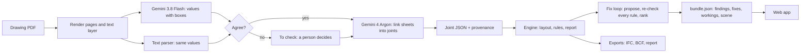

# ARCHITECTURE.md

## The system in one picture



Only the engine produces numbers. Gemini reads and proposes; the engine measures, judges and ranks.

## Repository

```
src/rebartwin/          engine (done): model, layout, geometry, rules, check, fixes, exports, report, cli, gemini_proposer
src/rebartwin/reader/   PDF reading, two channels, agreement, linking (R1 to R5)
src/rebartwin/api.py    API (built): FastAPI service (check, projects, upload, SSE events, to-check, bundles, exports, crops)
tests/                  engine, reader, API, and Gemini proposer tests (pytest)
examples/               joint JSON fixtures (c4_b12.json is the deck's worked example)
web/                    React app; web/src holds the v0 viewer built in Antigravity (to migrate, below)
docs/                   rules.md, orca-teardown.md, UI_RESEARCH.md
.agents/rules/          Antigravity rules loaded by file path
```

## Engine (built, 12 tests)

| Module | Job |
|---|---|
| `model.py` | `Joint`: one column, up to two beams (one per direction), bars in drawing notation, covers, aggregate, exposure, seismic zone. Millimetres. The reader's output contract |
| `layout.py` | Places every bar in 3D the way sites do: tight inside links, evenly spaced, layers in line on a spacer, crossing beams stacked |
| `geometry.py` | Exact segment-to-segment distances; gap = distance minus radii |
| `rules.py` | IS 456 spacing and cover, bar clashes, IS 13920 cl. 7.1.1 and 6.2.3; each rule records its clause and the source it was checked against |
| `check.py` | Runs the rules that apply; the only source of numbers |
| `fixes.py` | Propose, re-check every rule, retry with reasons, rank. `Proposer` protocol; `Enumerator` built in |
| `gemini_proposer.py` | `GeminiProposer(Proposer)` calling `reader/gemini.py` (`REBARTWIN_MODEL_LINK`, `propose_v1` prompt) for up to 6 stock-bar/max-layer candidates per round; engine re-checks and ranks everything |
| `export_ifc.py`, `export_bcf.py` | IFC4 (bars as `IfcReinforcingBar`, `Tag` = bar id, stable GlobalIds) and BCF 2.1 |
| `report.py` | Markdown report and `bundle()`, the web contract |

Conventions: millimetres; Z up; the column's centre line is the Z axis; Z = 0 is the top of the beams; beams run
along X or Y. Bar ids: `C4/V3` (column bar 3), `B12/T1-3` (top layer 1, bar 3), `B12/B2-1` (bottom layer 2, bar 1).

## Contracts

### bundle.json (one per joint)

```
joint            Joint as read (model.py): { id, column, beams[], settings, required_area{}, notes[],
                   place?, floor? }
  column         { id, b, h, n_bars, bar_dia, face_dia?, tie_dia, cover, cover_to, bars_x, bars_y,
                   face_along_x?, face_along_y? }
                   bar_dia is every bar's size, or with face_dia the four corner bars' size; face_dia is the size of
                   the n_bars - 4 bars between the corners ("4-16 + 4-12": n_bars 8, bar_dia 16, face_dia 12). Each
                   column bar in `scene` carries its own `dia`; draw from those, never from bar_dia alone.
                   face_along_x / face_along_y: where a fix placed the bars between the corners (mm from the centre
                   line, symmetric), on the faces that run along X / Y; null means spread evenly as drawn.
  place, floor   the column's grid place on the plans ("F-14", "C/C1-25") and the beams' floor ("FIRST"), when the
                   reader found them; null otherwise. Read these, never parse `id`.
report           { findings[], rules_run[], rules_skipped{}, passed{}, is13920, seismic_zone, notes[] }
  finding        { rule, clause, title, status: fail|pass, measured, limit, compare: >=|<=, unit,
                   margin, members[], bars[], at: [x,y,z] mm, span: [[x,y,z], [x,y,z]] mm | null, message }
fix              { status: clean|fixed|redesign|no_fix, summary, options[], attempts[], blocking{} }
                   an edit is set_face {beam, face, layers[]}, resize_column {b, h} or place_face_bars {along_x?,
                   along_y?}; an option with place_face_bars has `column` "C1 face bars at y = -40, 40 mm" and a flag
                   saying the 5 mm clearance to beam bars is a placing tolerance, not a code rule. Options rank: beam
                   changes only, then face bar placements (smallest move first, alone or with a beam change), then
                   redesigns. The loop stops after a round only when something passes without a redesign; while only
                   redesigns pass it runs the next round (up to two), where beam changes with placed face bars come.
  option         { candidate{title, edits[], source}, faces[{beam, face, before, after, area_before,
                   area_required, area_provided, overshoot_pct, depth_before, depth_after, n_bars_before,
                   n_layers_before, n_bars, n_layers}], column, flags[] }
  attempt        { round, candidate, passed, failures[{rule, clause, measured, limit, compare, margin, unit,
                   message, bars[], at, span}] }
rules            { id: {clause, title, basis} }
scene            { units: "mm", up: "z", concrete[{id, kind, min, max}],
                   bars[{id, member, role, layer, index, dia, p0, p1, label, status, findings[]}],
                   loops[{id, member, role, dia, points[]}] }
option_scenes[]  a scene per fix option, same order
attempt_scenes[] { concrete[], bars[] } per attempt (first 60); a bar's findings index that attempt's failures
provenance[]     { path, member, field, layer, page, box_2d, text, gemini, parser,
                   status: agreed|geometry|resolved|default, ocr_raw, joined_from, page_image,
                   refs: [{page, box_2d, text, at, page_image}] | null }   only in bundles written by `rebartwin read`
pages            { "<n>": "pages/page-<n>.png" }   page images copied beside bundle.json; paths relative to it
```

A bar's `findings` in `scene` index `report.findings`. The viewer never computes a number; it formats these.

- `margin` is signed, in the finding's `unit`: measured minus limit for `>=`, limit minus measured for `<=`, so
  positive passes and negative fails. Gauges and "short by" text read it; nothing subtracts in the web.
- `span` is a dimension to draw. IS 13920 cl. 7.1.1 has one: across the column along the beam, through the centre
  line, at the level of the beam's outer top bars (the 300 mm minimum: across the smaller side at z = 0). `at` is its
  midpoint, so the finding gets a 3D callout.
- `area_before`, `n_bars_before`, `n_layers_before` are the face as drawn, beside the fix's `area_provided`,
  `n_bars`, `n_layers`.
- Numbers in engine text (messages, flags, report.md) round half away from zero on the decimal value, as
  `Intl.NumberFormat` does by default (`rebartwin/numbers.py`): 388.5 mm reads "389 mm" in a flag and on a card. A failing
  value never rounds onto or across its limit, as in the web's `format.ts`: one more decimal at a time, up to three
  (24.667 mm against 25 mm reads "24.7 mm"; an overlap of 0.3 mm reads "0.3 mm", never "0 mm").
- Source (`provenance`, `pages`): `path` is the linking path, `box_2d` the drawing's box on `page`, `page_image`
  the copied image (crop it with `box_2d`). `agreed` values came from both channels; `geometry` values (a beam's
  `frames_into`) were made by code from the plans (`plan.py`): `page`, `box_2d` and `text` are the beam label on the
  beam layout, `refs` the column label on the column layout with its grid place (`at`, "F-14"), `gemini` empty;
  `default` values (`parser`
  holds the default, e.g. "20 mm") have no page, box or image; `resolved` marks a value a person gave in To check,
  written when the API re-checks a resolved joint. `level_by: "storey from the schedule's table"` marks a column
  value whose storey Gemini did not give: code took the header of the one ruled storey group the value sits in
  (agreement rule 6), and the joint's notes say so.

### provenance.json (reader)

A list, one entry per linked joint:

```
[{ "joint": "C4xB12",
   "fields": { "beams[0].top[0].bars": { "page": 3, "box_2d": [ymin, xmin, ymax, xmax], "text": "5-20",
               "gemini": "5-20", "parser": "5-20", "status": "agreed", "field_id": "f0012",
               "level": "FIRST FLOOR" | "FOUNDATION TO FIRST FLOOR" | null,
               "level_by": "storey from the schedule's table" (only when code gave the level),
               "ocr_raw": "4016" | null },
               "beams[0].top": [ {...}, {...} ] },
   "link_notes": ["what the linking model said, kept for a person; never copied into the joint"] }]
```

`box_2d` is Gemini's convention: integers 0 to 1000 relative to the page image, `[ymin, xmin, ymax, xmax]`; in
provenance it is the text layer's box. `text` is the drawing's own text, `gemini` what Gemini wrote, `parser` the
canonical value. Keys are the linking paths (`column.section`, `column.main`, `column.ties`, `column.cover`,
`beams[i].section|top|bottom|stirrups|cover|frames_into`, `settings.seismic_zone|exposure`); a face with one layer
from one field uses the per-layer key `beams[i].top[0].bars`, otherwise the face key holds a list.

### to_check.json (reader)

```
[{ "id": "tc_0007", "joint": "C4xB12" | null, "member": "B12" | null, "field": "top" | "beams[0].top",
   "layer": 1, "level": "FOUNDATION TO FIRST FLOOR" | null, "page": 3, "box_2d": [...] | null,
   "gemini": {"value": "5-20"} | null,
   "parser": {"value": "5-16"} | null, "reason": "disagree|missing|ambiguous", "detail": "a sentence for a person",
   "place": "N1-4" | null,
   "resolution": null | {"value": "5-20", "by": "person", "at": "2026-11-19T10:02:00Z"} }]
```

`field` is the read field (`section`, `top`, `top_extra`, `bottom`, `bottom_extra`, `main`, `links`, `cover`,
`concrete_grade`, `steel_grade`, `seismic_zone`, `exposure`, `frames_into`) for items from agreement, and a linking
path for items from linking. `joint` null with member ALL, ALL_BEAMS or ALL_COLUMNS, or field `seismic_zone` or
`exposure`, is a project-level item: it blocks every joint until resolved. A drawing that does not state the zone
or exposure gets one such item each (reason `missing`), never a silent zone II or mild: zone II would turn IS 13920
off. Otherwise `joint` null means the item blocks nothing (a member in no joint, a grade). `place` is the grid place
an item is about (a column drawn off the grid "near N1-4"): it blocks only joints at that place, so a column on no
grid intersection blocks none and its item stays with `joint` null.

A joint with unresolved items is shown as "To check" and is not checked until they are resolved.

### reading.json (reader)

The run: pdf name, pages, dpi, tile size, prompt versions (`read_v1`, `link_v1`), link model, seconds, text layer per
page (words, annotations by author, whether annotations were read), counts, tokens (live calls only), every call
(key, model, cached, tokens, latency), every accepted field with both boxes, and `unassigned`: values the parser read that Gemini did not report, shaped like To check items with
`joint` null. They block nothing; they show what Gemini missed. `plans`: `{beam_layouts, column_layouts,
alignment[{beam_page, column_page, x, y}], joints[{beam, column, at, level, beam_page, column_page}],
junctions[{beam, page, kind: "beam on beam"|"off grid", at?, detail}]}`; junctions are not To check items.

## Reader (Claude Code; `src/rebartwin/reader/`, `rebartwin read <pdf> --out out/<project>`)

1. **Ingest** (`ingest.py`, `ocr.py`). PyMuPDF renders each page at 200 dpi to `pages/page-<n>.png` and returns its
   text as words with `box_2d` boxes, mapped through the page rotation so they match the rendered image. Comments
   (annotations with content, such as "AutoCAD SHX Text", which hold the callouts on SHX-font sheets) are always
   merged as words, AutoCAD codes translated (%%C Ø, %%D °, %%P ±, %%% %, %%U and %%O dropped); a comment repeating a
   text-layer word in the same place is dropped. A page with no comments and fewer than 20 words (text exported as
   lines) is read by Cloud Vision DOCUMENT_TEXT_DETECTION (`VISION_API_KEY`), tiled like Gemini, replies saved and
   replayed; those OCR words feed the parser only, never Gemini's prompt. A Ø that OCR misread (0, O, Q, •, θ) is
   repaired in OCR words only, when exactly one split gives a standard callout: bars n-Ø-d (n 1 to 24, d 8 to 40)
   and links Ø-d @ s (d 6 to 12, s a multiple of 5 from 50 to 300); the raw text is kept as `ocr_raw` and repairs
   are counted in reading.json. A repaired value is accepted only if Gemini reads the same. `--probe` prints words,
   comments by author, comments merged, vector paths and whether OCR is needed, per page; never the text.
   Boxes are floats in box units everywhere inside the reader; only the output files hold integer `box_2d`.
   Drawn horizontal and vertical segments of at least 10 pt are ruling lines, minus strokes that lie inside a word
   (lettering exported as lines). Words in one small table cell (at most 8% of the page high, 30% wide) are one text
   run (`cells.py`): two-line headers read whole and neighbouring cells never run together. Pages with no grid group
   words by line as before.
2. **Gemini channel** (`gemini.py`). `REBARTWIN_MODEL_READ` (default `gemini-3.8-flash`), no sampling parameters
   (Gemini 3.6+ ignores and will reject temperature, top_p, top_k), JSON
   schema `PageReading`: callouts with member, field, layer, level, value as written, `box_2d`, page. `level` is
   the storey header a column value sits under ("FOUNDATION TO FIRST FLOOR") or the floor of a beam schedule or
   plan ("FIRST FLOOR"); prompt `read_v2`. Members ALL,
   ALL_BEAMS and ALL_COLUMNS mark general notes; `frames_into` (member = beam, value = column, box around both
   labels) is how the plan's topology is read. The prompt (`prompts/read_v1.md`) sends the image plus its text-layer
   lines and says numbers come only from the drawing. Sheets larger than 3000 px are read in overlapping tiles and
   boxes mapped back, `--concurrency` (default 3) at a time. google-genai retries 408, 429 and 5xx (4 attempts, up
   to 60 s); the reader retries only invalid replies. 403, 404 or a 429 with "limit: 0" means the key cannot use
   the model: no retry, linking falls back. Every reply is saved in `out/<project>/replies/` by a hash of model and
   parts and replayed on a re-run (`--replay` never calls the API). Logs ids, model, tokens and latency, never text.
3. **Parser channel** (`parser.py`). Member ids include XB and YB beams (XB12 runs along X, YB3 along Y: code checks
   the linking model's direction against the prefix, a mismatch is To check, and the note says so). A grammar over
   the text for Indian notation ("5-20", "2-25+1-20", "2#25",
   "8-T16", "3 nos 16φ", "230x450", "8φ @ 150 c/c", "2L-8 @ 100", "clear cover 25 mm", "C.C. 40", "M25",
   "Fe500", "zone III", member ids), on visual lines (CAD often splits one callout into several text objects),
   mapped to word boxes. Canonical values: bars "2-25 + 1-20", sections "230x450" (b x D), links "2L-8@100". No
   model.
4. **Agreement** (`agree.py`). Accept a callout only when both channels give the same canonical value at the same
   place (IoU at least 0.3, or one centre inside the other), the member is the label for that value in reading
   order (nearest same-kind id to its left in the row, else above in the column), a top or bottom label does not
   contradict the face, a column value's storey is the storey header above it (or beside it in its row) and a beam's
   or plan's floor is named on its sheet, and no other accepted callout gives the field another value at that
   level. When Gemini gives a column value no storey, the header is its level only if the value sits inside exactly
   one ruled storey group and that header names exactly one storey (one TO, two different floors); provenance then
   says `level_by: "storey from the schedule's table"`. A different storey from Gemini still disagrees. Everything else becomes a To
   check item with a reason. Ties use geometry before distance where the sheet has it: on a plan, a beam size on a
   beam band belongs to the XB or YB label tied to that band; on a detail sheet, a beam callout belongs to the
   elevation whose title ("XB1(200x600-inv)") is the nearest below it across its span; on a column layout, a size
   belongs to the column whose outline is nearest (`plan.py`). A ruled table whose header cell says COVER gives
   cover values scoped by their row (COLUMNS: ALL_COLUMNS, BEAMS: ALL_BEAMS); a Gemini cover for another scope
   disagrees. General notes read on many sheets give one project-level item per field, scope and value (the other
   pages listed), and none when that scope and value is accepted elsewhere. A column value's To check item carries
   the storey header it sits under, so it blocks only joints of that storey. Greek and Cyrillic look-alike capitals
   from OCR ("ΤΟ") read as Latin in storeys and floors. In OCR words, a hollow bar marker fused into the group after
   a "+" ("04012" for "○ 4Ø12") is dropped when the rest is exactly one callout.
4a. **Joints from geometry** (`plan.py`; item 4). Grid bubbles are short labels in drawn circles; each names the
   line that leaves its circle (directly, or through a short, possibly dashed, leader); bubble text is never a member
   id. A beam layout (grid plus XB/YB labels tied to bands of two parallel edges, dashes merged) is fitted onto the
   column layout per axis by shared grid labels (at least 2, worst residual under 0.5% of the span; else one To check
   item and no joints). Columns are labels tied to their filled outlines, covering the grid lines that cross them
   (close sub-grids such as B and B1 can both cross one column); a column off the grid is To check, with the place
   it is near as the item's `place`, so it blocks no joint of that column type elsewhere. A band meets a
   column when, mapped onto the column layout, it overlaps the outline across and reaches it along (one text height
   of slack, since edges stop at column faces): that is a `frames_into` field with status `geometry`, level the
   layout's title ("FIRST FLOOR BEAM LAYOUT") and `at` its place ("F-14"); one field per place. Slab marks in
   circles (S1, S14) are never bubbles. Different marks along one direction at a column, or a label between
   two bands, go to To check; a band ending where no column is, is a beam-on-beam junction in reading.json.
   `scripts/plan_joints.py` prints them with no API call.
5. **Linking** (`link.py`). `REBARTWIN_MODEL_LINK` (default `gemini-4-argon`; on model-not-found
   `REBARTWIN_MODEL_FALLBACK`) returns `{joints: [{joint, sources, unresolved}]}`, `joint` being
   `Joint.model_json_schema()`. The model chooses structure and cites, per linking path, the accepted field ids it
   used. Code then proves every number from the cited fields: a value that differs, has no field, or leaves out a
   drawn field becomes a To check item tied to the joint. Defaults and the model's structural choices (direction,
   column orientation, cover measured to, layer arrangement) are written into `Joint.notes` by code, never by the
   model. Joint ids are rebuilt from the members: `C4xB12xB13`, with `@<floor>` when the plans give one
   (`C4xB12@FIRST`) and `@<place>` when geometry gives the column's grid place (`C5xXB8@FIRST@F-14`,
   `C5xXB3xYB14@FIRST@C+C1-25`): one column type stands at many places, so the place keeps ids unique. Id parts are
   safe as Windows file names and URL path segments: "/" becomes "+", spaces "_", other characters outside
   letters, digits, `_ + . -` become "_". In a joint with a place, a beam's `top_extra` counts only if its `at` (the
   grid bubble under it on the detail sheet) is the beam's support line there (the number for a beam along X, the
   letter along Y); an extra with no `at` is an `ambiguous` item on `beams[i].top`, never a guess. An extra's `at`
   comes from a grid bubble under it on the detail sheet, else from mapping its elevation's supports (break marks
   under the beam) onto the plan's supports along that beam (columns plus beam-on-beam ends), left to right, only
   when the counts are equal and each span's share of the length matches within 3% in exactly one direction (or in
   both, when both give the same support for that callout). When the counts differ (a break mark missed or drawn
   twice, an elevation showing part of the beam), the marks are matched at the sheet's scale instead: the scale is
   the median of the elevations on that sheet, of the same prefix (XB or YB), whose 3 or more supports map in exactly
   one way, used only when there are at least two and they agree within 2%; then a run of consecutive plan supports
   fits a subset of the marks when every gap equals the plan gap times the scale within 1.5 title heights or 3%, and
   the answer must be the same under every run and direction that fits (fix A). Beam values by span (fix A): a size
   on a plan band, and a top or bottom bar callout on an elevation, carry `at` = the span they sit over, its two
   supports' grid lines joined by "/" ("14/18"), when the label is clearly between two supports; rule 7 then keeps
   values over different spans apart. At a joint, a beam's section, top and bottom are the values over spans ending
   on its support line there plus unplaced ones; equal values either side are one value; different values mean the
   beam changes at the column, an `ambiguous` item (the engine takes one beam per direction). A two-size elevation
   title ("200x450/200x600-inv") is not split by span: it stays To check. A joint the model cannot give every required number
   for (a number left at 0) is written as a draft, `joints/<id>.draft.json`: id, place, floor, storey, column and
   beams with, for each value, the accepted fields that give it or null, and the To check items blocking it, one of
   them naming the null paths. Never a placeholder number. The API lists drafts as blocked joints (`draft: true`)
   and never checks them; a wrong structure (two beams one way) is still "link it by hand". A `bottom_extra`'s
   `at` is the grid lines of the supports its drawn bar reaches on the elevation (its callout's leader followed to
   the bar; within half a title height of a support counts), or "-" for none; at a joint it counts only if it
   reaches that support, a bar that stops short is left out with a note in `Joint.notes`, and one whose end the
   drawing does not show is `ambiguous` on `beams[i].bottom`. Every Joint and draft carries `place` and `floor`
   fields, so nothing downstream parses the id. A column main of two sizes whose first group is 4 bars is corner
   and face bars (`face_dia`), noted with how the face bars are spread; any other mix is To check. The linking
   model's "unresolved" counts only on paths code has neither proved nor defaulted with a note. Prompt `link_v5`. A joint's floor is the floor of the plans its beams were read on; its column values must be
   from the storey that ends there and its beam values from that floor, and that choice is a note. Without a floor,
   a column with values for several storeys goes to To check. Prompt `link_v3` (adds `at`: one joint per place, top
   extras by support).
6. **Evaluation.** A golden set of 60 hand-labelled callouts; report accuracy per field. Target: at least 95%
   accepted and correct, zero wrong values accepted.

Replies: when `REBARTWIN_REPLIES_DIR` is set (in `.env`), every reply cache (Gemini read, Vision, linking,
proposer) saves to and replays from that one folder, whatever folder its caller names; tests hold it empty.

Keys: an AI Studio key in `GEMINI_API_KEY` locally; Vertex AI on Cloud Run (`GOOGLE_GENAI_USE_VERTEXAI=true`).
API reply caches (`CachingTransport`, `CachingOcr`, `GeminiProposer`) use `REBARTWIN_REPLIES_DIR` (default
`out/_replies`) with no per-project `replies` folder so saved readings replay across uploads.

## API (built, `src/rebartwin/api.py`; Vite proxies `/api/*` -> `http://127.0.0.1:8000/*`)

| Method and path | Does |
|---|---|
| `POST /joints/check` | Joint JSON in, bundle out. Stateless; used by demo mode and tests |
| `POST /projects` | Create a project |
| `POST /projects/{id}/drawings` | Upload a PDF; starts reading |
| `GET /projects/{id}/events` | Server-sent events: `page_started`, `page_read` (agreed, to_check), `joint_ready`, `done`, `error` |
| `GET /projects/{id}` | Sheets, overview counts, failures by rule, beam-on-beam junctions, joints (including `draft: true` blocked drafts) with explicit `place`/`floor` and blocking items |
| `GET /projects/{id}/to-check` and `POST .../to-check/{item}/resolve` | The review queue |
| `GET /projects/{id}/joints/{joint}/bundle` | The bundle |
| `GET .../joint.ifc`, `.../fixed.ifc?option=n`, `.../issues.bcf`, `.../report.md` | Exports |
| `GET /projects/{id}/pages/{n}.png?crop=ymin,xmin,ymax,xmax` | A drawing crop for the Source panel |

Errors use `application/problem+json`. Long work runs as Cloud Tasks; the API streams progress.

## Web app

**Stack.** Vite, React 19, TypeScript (strict), Tailwind CSS v4 with tokens from DESIGN_SYSTEM.md, shadcn/ui on
Radix primitives, Motion (`motion/react`) for interface animation, three.js with an imperative `SceneController`,
`camera-controls` for camera moves, React Router 7, TanStack Query, Zustand, cmdk, sonner, lucide-react,
self-hosted fonts via @fontsource. Landing route only, lazy-loaded: GSAP with ScrollTrigger and SplitText, and Lenis.
web-ifc stays, lazy-loaded, behind "Open IFC".

**Routes.**

| Route | Screen |
|---|---|
| `/` | Landing |
| `/demo` | The worked example, offline, with the guided tour |
| `/projects/:id` | Project overview: counts (`found`, `checked`, `failing`, `blocked`), failures-by-rule chart, sorted joints with worst failure and links (`Joint`, `Report`, `To check`), beam-on-beam junctions as info |
| `/projects/:id/upload` | Upload and reading progress |
| `/projects/:id/review` | To check queue |
| `/projects/:id/joints/:jointId` | Joint workspace (`?f=` selected finding, `?o=` option, `?a=` attempt) |
| `/projects/:id/report` | Printable A4 pre-pour report (`?joint=`, `?variant=`, `?option=`) |
| `/styleguide` | Tokens and components in both themes (dev only) |

**Folders.**

```
web/src/
  app/          router, providers, shells
  routes/       one file per route
  features/     workspace/ (Viewport, SceneController.ts, callouts, toolbar, inspector),
                findings/, fixes/, workings/, source/, reading/, review/, report/, project/, landing/
  components/   ui/ (shadcn, generated) and shared custom components
  lib/          api.ts, calloutGrammar.ts, calloutLayout.ts, coords.ts, demoData.ts, format.ts, motion.ts, provenance.ts, routes.ts, a11y.ts
  stores/       workspace.ts (Zustand)
  styles/       tokens.css, globals.css
  types/        bundle.ts (mirrors the contract above)
```

**From the v0 viewer.** Keep `coords.ts` (the mm Z-up to m Y-up conversion) and the label-projection logic from
`Viewport3D.tsx`. Move `ifcLoader.ts` behind "Open IFC". Rebuild panels on the design system; retire
`styles.css` once nothing uses it.

**Scene.** `SceneController` builds meshes from `scene`: each bar a unit cylinder scaled to its diameter and length
and oriented from `p0` to `p1`, so a morph is a tween of position, rotation and scale; loops as tubes along their
polylines; concrete as boxes with edge lines. Picking returns `bar.id`. Labels are HTML in an overlay, projected
each frame, so text stays crisp and accessible. Before and After matches bars by id: moved bars tween, removed bars
shrink out, new bars grow in. Units convert once, in `coords.ts`: engine `(x, y, z)` mm to three.js
`(x, z, -y) × 0.001`.

**State.** Zustand holds selection, mode (before, after), option, replay (playing, index, speed), concrete and
label modes. The URL holds the joint and the selected finding, option or attempt, so any view can be shared.

**Budgets.** First render under 1.5 s on a laptop; app JavaScript under 250 KB gzipped before the 3D chunk;
60 fps orbit on integrated graphics; landing Lighthouse at least 90 for performance and accessibility.

## Google Cloud (showcase onward)

Cloud Run serves the API and the built web app. Cloud Tasks reads pages in parallel. Cloud Storage holds uploads,
deleted after export (lifecycle rule: 1 day). Firestore holds projects, joints and To check state. BigQuery logs
every model call: model, tokens, latency, cost, and whether the two channels agreed. Vertex AI serves Gemini. One
service account with only these roles; keys in Secret Manager.

## Privacy

Drawings are the client's property: never in git, never in logs, deleted after export. Crops are served through
short-lived URLs. Logs carry ids and numbers, not drawing content.

## Testing

| Layer | How |
|---|---|
| Engine | pytest with hand-checked numbers; IfcOpenShell kernel cross-check |
| Reader | parser unit tests per notation; golden-set accuracy report |
| API | pytest with FastAPI's test client |
| Web | Vitest and Testing Library for components; Playwright for the demo flow; axe on every route |

## Decisions

1. **Closed-form geometry is the truth.** A bar is a segment with a diameter, so gaps have a formula. IfcOpenShell's
   kernel re-measures the exported model as a second channel; they agree on the worked example.
2. **The web draws `scene`, not IFC.** Exact, light, easy to pick and animate. IFC and BCF are exports for BIM tools;
   web-ifc remains for opening outside IFC files.
3. **One bundle per joint.** Static-friendly, so the demo runs with no server and no network.
4. **A single-page app.** React Router view transitions and Motion's `AnimatePresence`; Barba is for multi-page sites
   and would fight the router.
5. **Motion for the interface, GSAP for the landing story.** Camera moves use `camera-controls`. Lenis on the landing
   only; never in the workspace, which has its own scroll areas.
6. **Radix primitives underneath.** Outside components (21st.dev, React Bits, Skiper UI, Watermelon) are copied in,
   reviewed for accessibility and restyled to tokens before use.
7. **Two reading channels.** Agreement or a person; never a silent pick.
8. **Vanilla three.js.** One joint is a few dozen meshes; the v0 viewer already works this way.
