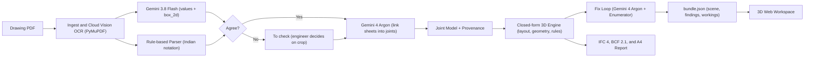

# RebarTwin

Indian structural drawings split column and beam reinforcement across separate 2D PDF sheets. At each beam-column corner, column bars, crossing beam bars, ties, and stirrups share one concrete core, so bar collisions and code violations often stay hidden until crews tie steel on site.

RebarTwin reads structural drawing PDFs, rebuilds every beam-column joint in 3D from the drawing's own numbers, proves which IS 456 and IS 13920 detailing rules fail, and finds fixes that pass every rule. Gemini reads and proposes; formal 3D geometry decides. Advisory: the engineer of record decides.

Team Building Bad · Google DeepMind × Google Cloud Startup Buildathon India 2026.

## Live Demo

Public read-only deployment (`DEMO_ONLY=true` on Cloud Run in `asia-south1`):

| Route | What it shows |
|---|---|
| [Live App](https://rebartwin-17371270384.asia-south1.run.app) | Product overview, neuro-symbolic architecture, and interactive Before/After preview |
| [IIT Hyderabad 3D Joint](https://rebartwin-17371270384.asia-south1.run.app/demo/iit) | Real tender drawing joint (`C1 × XB17`, 9 failures proved in 3D, CAD sheet crops, fix without resize) |
| [Pre-Pour A4 Report](https://rebartwin-17371270384.asia-south1.run.app/demo/iit/report) | Print-ready A4 verification sheet, effective-depth flags, provenance ledger, IFC/BCF exports |
| [Worked Example Tour](https://rebartwin-17371270384.asia-south1.run.app/demo) | Guided 5-beat tour on `C4 × B12` across Zone II and Zone III (`IS 13920 cl. 7.1.1`) |

See [docs/DEMO.md](docs/DEMO.md) for the offline presenter runbook and Cloud Run instructions.

## How It Works



On Google's Physical-Engineering's Last Exam (November 2026), frontier models met 91% of single constraints yet only 41% of designs passed every safety rule together. RebarTwin pairs multimodal Gemini with a deterministic 3D verifier so each component does what it does best:

| Component | Model / Tool | Role |
|---|---|---|
| Visual sheet reading | `Gemini 3.8 Flash` | Reads messy A1 schedule tables, local abbreviations, and elevation callouts with `box_2d` coordinates (`read_v2`) |
| Cross-check parser & OCR | `Cloud Vision OCR` + regex parser | Recovers CAD SHX line-stroke text with Ø repair; any disagreement pauses in `To check` instead of guessing |
| Cross-sheet linking & fix proposals | `Gemini 4 Argon` | Connects framing plans, elevations, and schedules into joints (`link_v5`) and proposes bar arrangements (`propose_v1`) |
| 3D verifier & ranker | Deterministic Python engine | Places every bar in millimetres (Z up), verifies all 8 rules, re-checks every candidate, and outputs every UI number |

Note: Model names in [gemini.py](src/rebartwin/reader/gemini.py) and [link.py](src/rebartwin/reader/link.py) are configured behind a swappable `Transport` with strict JSON schemas and deterministic reply caching (`REBARTWIN_REPLIES_DIR`).

## Proof on Real and Worked Drawings

### 1. Real Tender Drawing: IIT Hyderabad Director's Residence (`/demo/iit`)

- **Input**: 10 A1 structural sheets (pages 7 to 9, 15 to 21) including mixed column longitudinal steel (`4-16` corners + `4-12` face bars) on `C1` (`200 × 450 mm`) meeting `XB17` (`200 × 450 mm`, top `2-12 + 2-16`) at First Floor.
- **What fails as drawn (`9` failures)**: 8 hard bar collisions (`7 mm` physical overlap between `XB17` longitudinal bars and `C1` `12 mm` face bars) plus 1 horizontal spacing failure (`24.7 mm` measured clear gap vs `25 mm` minimum under `IS 456 cl. 26.3.2`).
- **Verified fix without column resize**: Split `XB17` top bars into two layers (`2-16` outer, `2-12` inner) and shift `C1` `12 mm` face bars symmetrically to `y = -40, 40 mm` (`5 mm` placing clearance tolerance noted; `15 mm` effective depth drop `410` to `395 mm` flagged for engineer recheck). Across all tried candidates, `78` of `102` arrangements pass every rule.
- **Single-building stratified reader check**: On a 60-callout stratified sample from this drawing set (`out/golden_60.json`, 59 labeled: 35 auto-accepted + 24 `To check`), auto-accepted precision was `35 / 35` (`100%`) with `0` wrong values accepted, while `To check` intercepted `16` wrong single-channel reads before they reached the 3D engine.

### 2. Pitch-Deck Worked Example (`/demo`, `C4 × B12`)

Column `C4` (`300 × 300 mm`, `8-16`) meeting beam `B12` (`230 × 450 mm`, top `5-20`):

- **Zone II (`IS 13920` off)**: `16 mm` clear horizontal gap fails `IS 456 cl. 26.3.2` (`25 mm` needed), and the middle top bar runs `18 mm` into `C4` face bars on both faces. Best fix: `2-25` over `2-20` in two layers (`1,610 mm²` provided vs `1,571 mm²` drawn, effective depth drop `407` to `386 mm` flagged). IfcOpenShell's geometry kernel confirms the same clashes in the exported IFC4 model.
- **Zone III (`IS 13920` on)**: `IS 13920 cl. 7.1.1` also fails (`300 mm` column depth vs `400 mm` required for `20 mm` beam bars). No bar rearrangement alone passes; the smallest redesign is `C4` `325 × 300 mm` with `4-16` over `4-16`, left to the engineer of record.

## Who Uses RebarTwin First & Phase 1 Scope

RebarTwin targets three buyers with immediate pre-pour financial or QA incentives:
1. **Structural proof-checking and PMC QA-QC teams** reviewing GFC sets with traceable PDF crop citations and BCF issues.
2. **Turnkey Design-Build EPC contractors** preventing on-site rebar clashes, cold joints, and slab pour delays.
3. **Mid-to-large design consultancies** running an automated pre-issue detailing gate before releasing A1 sheets to site.

### Checked Rules (8 Interior-Joint Checks)

| Rule ID | Clause | Requirement Checked in 3D |
|---|---|---|
| `IS456-26.3.2-H` | `IS 456:2000 cl. 26.3.2` | Clear horizontal bar gap `>= max(bar dia, aggregate + 5 mm)` |
| `IS456-26.3.2-V` | `IS 456:2000 cl. 26.3.2` | Clear vertical layer gap `>= max(15 mm, 2/3 * aggregate, bar dia)` |
| `IS456-26.3.2-L` | `IS 456:2000 cl. 26.3.2` | Multi-layer bars vertically in line (within `1.0 mm`) |
| `IS456-26.4.2` | `IS 456:2000 cl. 26.4.2`, Table 16 | Cover to links/stirrups by exposure (`20` to `75 mm`; `5 mm` mild small-bar exception) |
| `IS456-26.4.2.1` | `IS 456:2000 cl. 26.4.2.1` | Column main bar cover `>= max(40 mm, bar dia)` (`25 mm` exception for `<= 200 mm` columns with `<= 12 mm` bars) |
| `GEOM-CLASH` | Geometry | Hard 3D bar-to-bar overlap (`gap < -0.01 mm`; touching allowed) |
| `IS13920-7.1.1` | `IS 13920:2016 cl. 7.1.1` | Seismic Zones III to V: column dimension `>= 300 mm` and `>= 20 * db` along each beam |
| `IS13920-6.2.3` | `IS 13920:2016 cl. 6.2.3` | Seismic Zones III to V: bottom beam steel at joint face `>= 50%` of top steel |

Full rule definitions and placement conventions live in [docs/rules.md](docs/rules.md).

**Not modelled yet**: Anchorage and development length (`IS 13920 cl. 6.2.5`), lap splices, special confining ties in and around the joint, minimum/maximum reinforcement ratios, exterior/corner joints, and inverted beams (`-inv` beams are blocked in `To check` as non-clearable `unsupported` items). Existing rule texts were compiled from engineering summaries and IITGN/NICEE worked examples and still require final line-by-line verification against official BIS editions (`E2` in [IMPLEMENTATION_PLAN.md](IMPLEMENTATION_PLAN.md)).

## Quickstart

Requires Python `>= 3.10` (`uv` recommended) and Node.js `>= 20`.

### 1. Run the deterministic engine CLI

```powershell
uv sync --extra ifc
uv run rebartwin check examples/c4_b12.json --out out/C4xB12
uv run rebartwin check examples/c4_b12.json --zone III --out out/C4xB12-zone3
```

Without IfcOpenShell, omit `--extra ifc` and add `--no-ifc`: all geometric checks still run. Or with `pip`: `pip install -e ".[ifc]" pytest`.

### 2. Run the PDF reader CLI (optional, needs API keys)

Copy `.env.example` to `.env`, set `GEMINI_API_KEY` (and `VISION_API_KEY` for OCR recovery), or point `REBARTWIN_REPLIES_DIR` at saved cached replies:

```powershell
uv sync --extra ifc --extra reader --extra api
uv run rebartwin read uploads/<drawing>.pdf --out out/<project>
```

### 3. Run the FastAPI service + React 3D workspace locally

Terminal 1 (API on `127.0.0.1:8000`):

```powershell
uv sync --extra ifc --extra reader --extra api
uv run uvicorn rebartwin.api:app --host 127.0.0.1 --port 8000
```

Terminal 2 (Vite dev server on `127.0.0.1:5173`):

```powershell
cd web
npm install
npm run dev
```

To run the production offline preview (both `/demo` and `/demo/iit` work with the API stopped):

```powershell
cd web
npm run build
npm run preview -- --host 127.0.0.1 --port 4173
```

### 4. Deploy public Cloud Run (`DEMO_ONLY=true`)

RebarTwin builds as a single container ([Dockerfile](Dockerfile)) serving `web/dist` and FastAPI on `$PORT`. With `DEMO_ONLY=true`, upload and edit endpoints return `403 application/problem+json` and zero API keys sit in the container:

```powershell
gcloud run deploy rebartwin --source . --project=rebartwin --region=asia-south1 --allow-unauthenticated --set-env-vars="DEMO_ONLY=true" --memory=1Gi
```

## Outputs

Every checked joint writes:
- `report.md`: failing rules, measured vs code limit values, ranked fixes, and assumptions.
- `bundle.json`: 3D bar geometry, `option_scenes`, `attempt_scenes`, provenance crops, and findings consumed by the web app.
- `joint.ifc` and `fixed.ifc`: IFC4 models (failing bars highlighted in red, cross-checked with IfcOpenShell).
- `issues.bcf`: BCF 2.1 issue package (one issue per failing rule).

## Testing & Verification

Run all backend and frontend verification gates:

```powershell
uv run pytest
cd web
npm run lint
npm run typecheck
npm test
npm run build
npm run e2e
```

Verified on `master`: `324` pytest cases pass, ESLint and `tsc` pass with zero errors or warnings, `46` Vitest unit/integration tests pass, Vite builds cleanly (pruning non-demo live caches from `dist/live/`), and all `22` Playwright E2E specs pass across dark/light themes, `axe-core` WCAG 2.2 AA accessibility checks, keyboard-only navigation, reduced motion, and `320 px` responsive reflow.

## Repository Layout

```text
src/rebartwin/
  model.py            Pydantic joint contract (millimetres, Z up)
  layout.py           Deterministic 3D bar placement inside ties and stirrups
  geometry.py         Exact segment-to-segment distances
  rules.py            IS 456, IS 13920, and 3D clash rules with clause bases
  check.py            Rule runner (sole source of verified numbers)
  fixes.py            Fix loop: propose, re-check every rule, rank, Workings log
  gemini_proposer.py  Gemini 4 Argon candidate proposer (Proposer protocol)
  export_ifc.py       IFC4 export + IfcOpenShell clash cross-check
  export_bcf.py       BCF 2.1 issue export
  report.py           Markdown report and web bundle serializer
  cli.py              CLI (`rebartwin check`, `rebartwin read`)
  api.py              FastAPI service (upload, SSE events, To check, bundles, crops, DEMO_ONLY guards)
  reader/             PyMuPDF ingest, Cloud Vision OCR, parser, agreement, plan alignment, link_v5
web/                  Vite + React + TypeScript + Tailwind v4 + three.js + web-ifc workspace
examples/             Worked example JSON (`c4_b12.json`)
tests/                Engine, reader, proposer, export, and API pytest suites
docs/                 rules.md, DEMO.md, orca-teardown.md, UI_RESEARCH.md
```

## Documentation

- [PRODUCT.md](PRODUCT.md): problem statement, target users, and milestones.
- [ARCHITECTURE.md](ARCHITECTURE.md): system diagram, API and `bundle.json` contracts, reader pipeline.
- [DESIGN_SYSTEM.md](DESIGN_SYSTEM.md): tokens, typography, motion, status grammar, and WCAG 2.2 AA rules.
- [docs/rules.md](docs/rules.md): clause details, placement conventions, and unmodelled scope.
- [docs/DEMO.md](docs/DEMO.md): live rehearsal path, offline fallbacks, and Cloud Run setup.
- [PROVENANCE.md](PROVENANCE.md): milestone build log and data notes.
- [THIRD_PARTY_NOTICES.md](THIRD_PARTY_NOTICES.md): open-source notices (ORCA MIT notice).
